<a href="https://saikanagat.com/papers/monocular-biomechanics"></a>

# BioMotion-AI

A scaffold for a single-camera biomechanics pipeline: video in, estimates of motion and joint force out.

**Status: early scaffold.** The modules under `src/` are small stubs that fix the shapes and interfaces between stages. No trained model ships here, and the numbers in `config.yaml` are target gates, not measured results.

## The pipeline

| Stage | Folder | What is there today |
|---|---|---|
| Visual frontend | `src/frontend/` | Ingestion, face blurring and pose stubs |
| Kinetics | `src/kinetics/` | Gait dynamics and physics consistency stubs |
| Simulation | `src/simulation/` | Muscle control and synergy skeletons |
| Biomarkers | `src/biomarkers/` | Knee contact force estimator scaffold |

## Run the checks

```bash
python -m pip install -r requirements.txt
pytest -q
```

The tests cover pipeline shapes, config thresholds and the latency gate.

## Target gates

Set in [config.yaml](config.yaml): 16.6 ms latency, joint angle RMSE up to 4.5 degrees, ground reaction force error up to 3.9%, knee contact force R2 of at least 0.95. Benchmark on a desktop GPU first, then tune for mobile chips.

## Read further

- [Architecture spec](ARCHITECTURE_SPEC.md). It keeps its source citation markers (`[cite: N]`) on purpose.
- [Testing strategy](docs/testing_strategy.md)
- [The paper](https://saikanagat.com/papers/monocular-biomechanics)
